# Clawd — пиксельные стикеры

Пиксельный Clawd (маскот Claude Code) без обводки и фона, все файлы в SVG.
Каждый «пиксель» — это 1 единица `viewBox`, рендер с `shape-rendering="crispEdges"`, поэтому стикеры остаются чёткими при любом масштабе.

Пересобрать или поправить: отредактировать `generate.py` и запустить `python3 generate.py`.

| | Файл | Стикер |
|---|---|---|
| 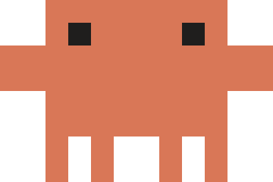 | `01-default.svg` | Clawd |
| 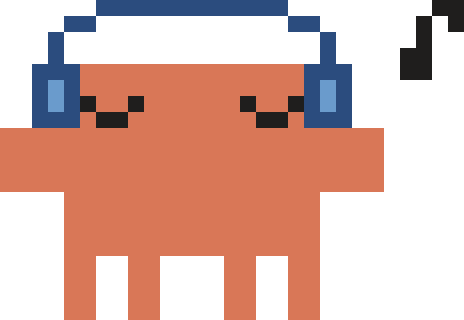 | `02-headphones.svg` | Clawd в наушниках |
| 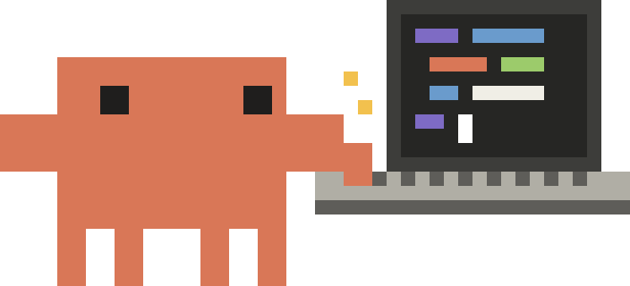 | `03-laptop.svg` | Clawd пишет код |
| 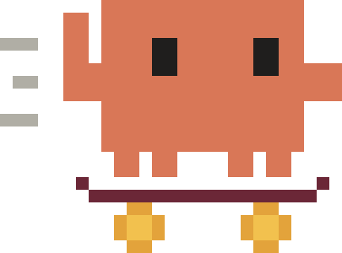 | `04-skateboard.svg` | Clawd на скейте |
| 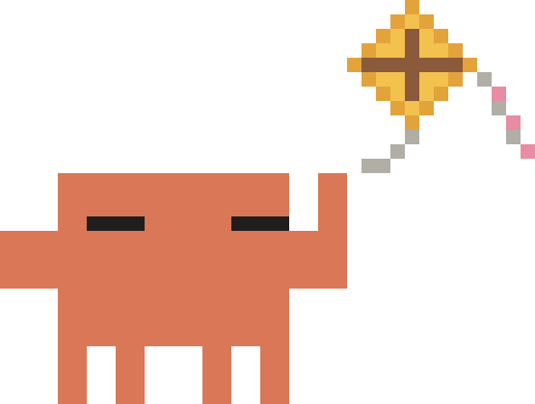 | `05-kite.svg` | Clawd с воздушным змеем |
| 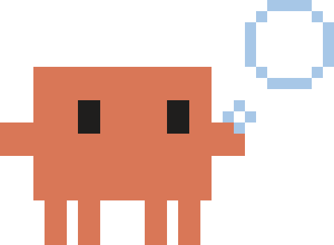 | `06-bubble.svg` | Clawd надувает пузырь |
| 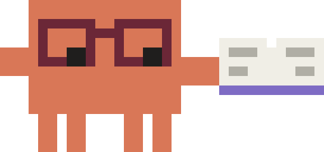 | `07-reading.svg` | Clawd читает |
| 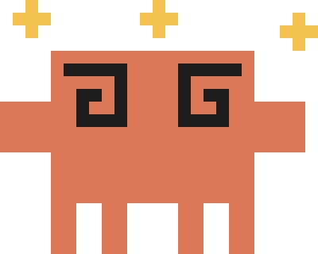 | `08-dizzy.svg` | Clawd в шоке |
| 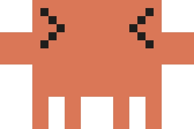 | `09-excited.svg` | Clawd > < |
| 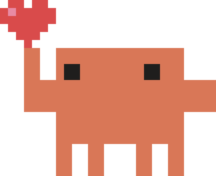 | `10-love.svg` | Clawd с сердечком |
| 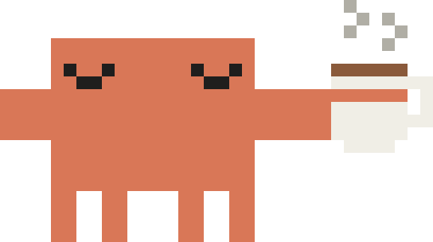 | `11-coffee.svg` | Clawd с кофе |
| 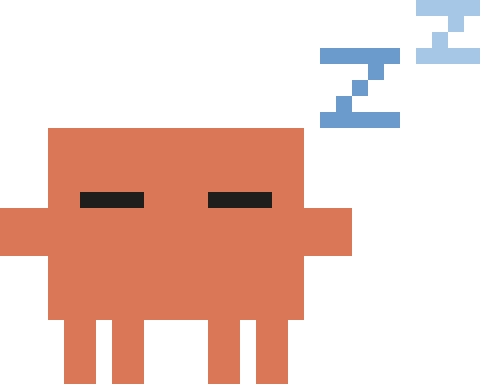 | `12-sleep.svg` | Clawd спит |
| 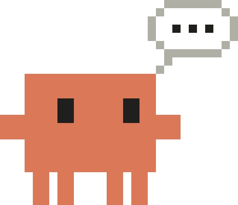 | `13-thinking.svg` | Clawd думает |
| 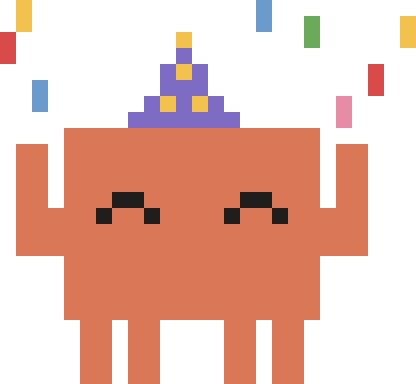 | `14-party.svg` | Clawd празднует |
| 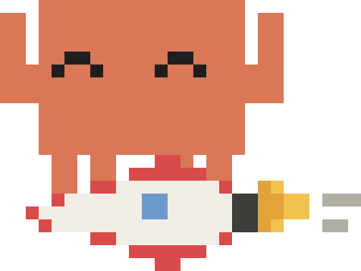 | `15-rocket.svg` | Clawd: ship it! |
| 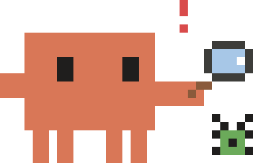 | `16-bug.svg` | Clawd нашёл баг |
| 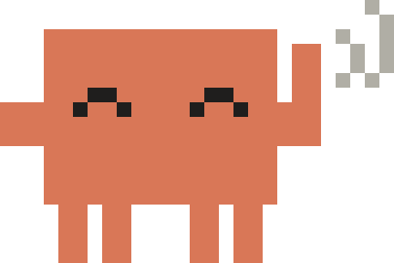 | `17-wave.svg` | Clawd машет |
| 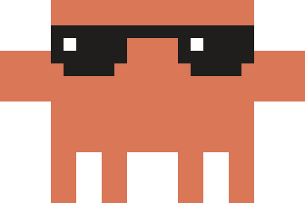 | `18-cool.svg` | Clawd в очках |
| 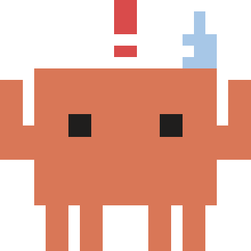 | `19-error.svg` | Clawd: что-то пошло не так |
| 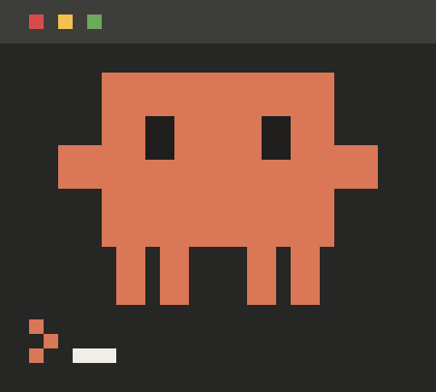 | `20-terminal.svg` | Clawd в терминале |
